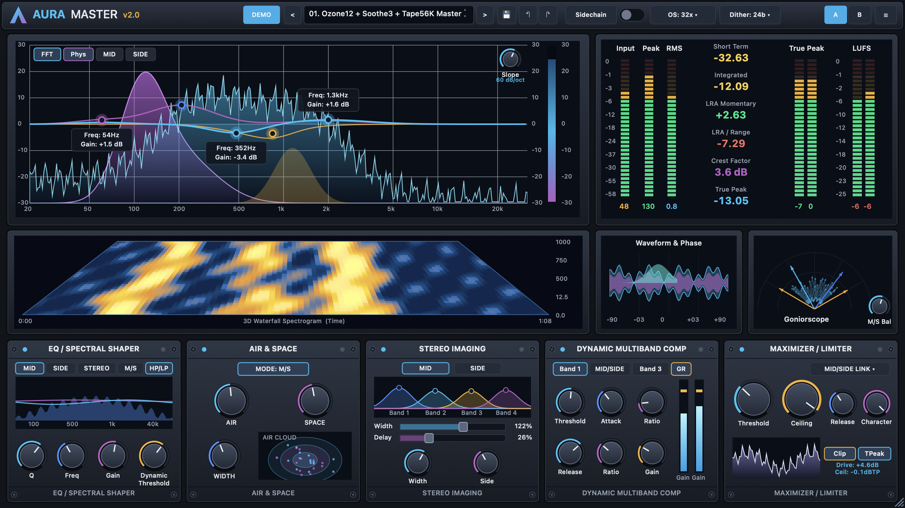

# Aura Vintage Studio Suite (`Aura Master v2.0` & `VSR-9512X`)

Universal macOS (`arm64` + `x86_64`) **VST3**, **Audio Unit (`aufx`)**, and **Standalone CoreAudio App** studio mastering & vintage sampler DSP plugin suite.



---

## Pre-Built macOS Universal Apps & Plugins Included in This Repository

### 1. **Aura Master v2.0** (`vsr-master-suite/build/`)
- **Standalone App**: [`vsr-master-suite/build/VSR-MASTER.app`](./vsr-master-suite/build/VSR-MASTER.app)
- **VST3 Plugin**: [`vsr-master-suite/build/VSR-MASTER.vst3`](./vsr-master-suite/build/VSR-MASTER.vst3)
- **Audio Unit (`aufx`)**: [`vsr-master-suite/build/VSR-MASTER.component`](./vsr-master-suite/build/VSR-MASTER.component)
- **Ready-to-Download Archive**: [`releases/Aura-Master-v2.0-macOS-Universal.zip`](./releases/Aura-Master-v2.0-macOS-Universal.zip)

### 2. **VSR-9512X Vintage Sampler & Compressor Rack** (`vintage-studio-rack/build/`)
- **Standalone App**: [`vintage-studio-rack/build/VSR-9512X.app`](./vintage-studio-rack/build/VSR-9512X.app)
- **VST3 Plugin**: [`vintage-studio-rack/build/VSR-9512X.vst3`](./vintage-studio-rack/build/VSR-9512X.vst3)
- **Audio Unit (`aufx`)**: [`vintage-studio-rack/build/VSR-9512X.component`](./vintage-studio-rack/build/VSR-9512X.component)
- **Ready-to-Download Archive**: [`releases/VSR-9512X-macOS-Universal.zip`](./releases/VSR-9512X-macOS-Universal.zip)

---

## Architecture & Features

### [`vsr-master-suite/`](./vsr-master-suite) — **Aura Master v2.0** Master Bus Console
A 64-bit floating-point / 24-bit fixed-point hybrid Master Bus processor combining reverse-engineered DSP topologies from **iZotope Ozone 12 Advanced**, **PAA Audio Tape56K**, and **Oeksound Soothe3** inside a 60 FPS resizable 16:9 hardware console UI (`800×450` to `2560×1440`):

- **Tier 1 — Global Transport & Mastering Bar**: Preset browser (`<` `>`), Save (`💾`), Undo/Redo (`↶` `↷`), `Sidechain` detector switch, `Oversampling (4x / 8x / 16x / 32x)`, `Dither (24-Bit TPDF / 16-Bit / Off)`, `A / B` comparison banks, and 5 hardware skins (`Obsidian`, `24K Gold`, `Tape56K Bronze`, `Heritage Titanium`, `Cyber Violet`).
- **Tier 2 — Upper Primary Analysis Deck**:
  - **Left**: Interactive 5-Band Bézier EQ & 60 FPS FFT Analyzer with `FFT`, `Phys`, `MID`, `SIDE` overlay toggles, variable `Slope (6–96 dB/oct)` rotary encoder, and 2D draggable nodes with live `Freq | Gain` callout badges.
  - **Right**: 34-segment LED bar meters (`Input`, `Peak`, `RMS`, `True Peak`, `LUFS`) and 6 live digital readouts (`Short Term`, `Integrated`, `LRA Momentary`, `LRA / Range`, `Crest Factor`, `True Peak`).
- **Tier 3 — Middle Temporal & Spatial Visualizers**:
  - **Left**: 3D Perspective Thermal Waterfall Spectrogram (`0:00` to `1:08`).
  - **Right**: Dual-layer scrolling Mastering Waveform & Phase Correlation monitor + Polar Goniometer / Vectorscope with `M/S Balance` control.
- **Tier 4 — Bottom 5-Module Hardware Processing Rack**:
  1. `EQ / SPECTRAL SHAPER` (`MID / SIDE / STEREO / M/S`, `HP/LP`, `Q`, `Freq`, `Gain`, `Dynamic Threshold`)
  2. `AIR & SPACE` (`STEREO / MS` mode, `AIR`, `SPACE`, `WIDTH`, real-time 2D Air Cloud visualizer)
  3. `STEREO IMAGING` (`MID / SIDE`, interactive 4-band crossover display, `Width` & `Delay` sliders, `Width` & `Side` rotary encoders)
  4. `DYNAMIC MULTIBAND COMP` (`Band 1`, `MID/SIDE`, `Band 3`, `GR` toggle, 6 rotary encoders, dual vertical plasma-cyan `Gain` reduction meters)
  5. `MAXIMIZER / LIMITER` (`MID/SIDE LINK` mode selector, `Threshold`, `Ceiling`, `Release`, `Character`, `Clip`, `TPeak`, and live scrolling attenuation waveform trace)

---

## Building from Source

```bash
# Build Aura Master v2.0 (VST3, AU, Standalone)
cd vsr-master-suite && ./build.sh

# Build VSR-9512X Vintage Studio Rack (VST3, AU, Standalone)
cd ../vintage-studio-rack && ./build.sh
```
